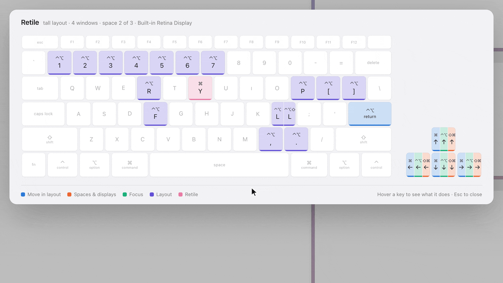
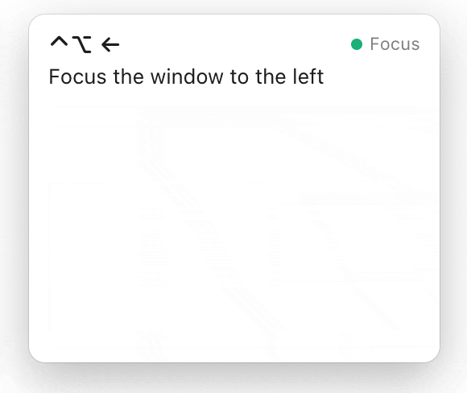
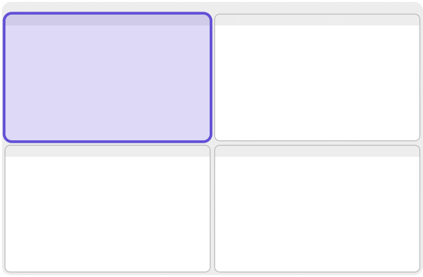

# Retile

A tiling window manager for [Hammerspoon](https://www.hammerspoon.org), driven
by hotkeys. ⌘Y shows a keyboard map of every binding: hover a key to see what
it does, acted out on a small model of your screen.

<picture><source media="(prefers-color-scheme: dark)" srcset="media/hero-dark.gif"></picture>

<p>
<picture><source media="(prefers-color-scheme: dark)" srcset="media/swap-dark.gif"></picture>
<picture><source media="(prefers-color-scheme: dark)" srcset="media/focus-dark.gif"></picture>
<picture><source media="(prefers-color-scheme: dark)" srcset="media/edge-dark.gif"></picture>
<picture><source media="(prefers-color-scheme: dark)" srcset="media/space-dark.gif"></picture>
<picture><source media="(prefers-color-scheme: dark)" srcset="media/display-dark.gif"></picture>
<picture><source media="(prefers-color-scheme: dark)" srcset="media/float-dark.gif"></picture>
<picture><source media="(prefers-color-scheme: dark)" srcset="media/pause-dark.gif"></picture>
<picture><source media="(prefers-color-scheme: dark)" srcset="media/resize-dark.gif"></picture>
<picture><source media="(prefers-color-scheme: dark)" srcset="media/masters-dark.gif"></picture>
</p>

<picture><source media="(prefers-color-scheme: dark)" srcset="media/layouts-dark.gif"></picture>

## Install

```sh
ln -s "$PWD/Retile.spoon" ~/.hammerspoon/Spoons/Retile.spoon
```

Then add to `~/.hammerspoon/init.lua` and reload Hammerspoon:

```lua
hs.loadSpoon("Retile")
spoon.Retile:start()
```

Hammerspoon needs Accessibility access. Moving windows between spaces uses
macOS's "Move left a space" / "Move right a space" shortcuts, so keep them on
in System Settings > Keyboard > Keyboard Shortcuts > Mission Control.

## Default keys

| Keys | Action |
| --- | --- |
| ⌘Y | Show or hide the keyboard map (Esc also closes it) |
| ⌘ ←→↑↓ | Move the window within its layout |
| ⌃⌥↩ | Swap the window with the main window |
| ⇧⌘ ←→ | Move the window to the previous / next space, following it; a new space is added past the last one |
| ⇧⌘ ↑↓ | Move the window to the display above / below |
| ⌃⌥ ←→↑↓ | Focus the neighbouring window |
| ⌃⌥ 1-7 | Layout: grid, tall, wide, columns, rows, spiral, monocle |
| ⌃⌥L / ⌃⌥⇧L | Next / previous layout |
| ⌃⌥[ / ⌃⌥] | Shrink / grow the main area |
| ⌃⌥, / ⌃⌥. | Fewer / more windows in the main area |
| ⌃⌥F | Float or tile the focused window |
| ⌃⌥P | Pause or resume tiling on this space |
| ⌃⌥R | Re-tile every screen |

⌘ and ⇧⌘ with the arrows replace the text-editing shortcuts for jumping and
selecting to line or document start/end while Retile runs, and ⌘Y replaces any
app's ⌘Y. Rebind them under `keys` if you need those.

Layout, main-area size, main-window count, window order and pause are kept per
space and display.

## Settings

Pass any of these to `start`; unknown or invalid settings are reported in the
Hammerspoon console and Retile stays off.

| Setting | Default | |
| --- | --- | --- |
| `layout` | `"grid"` | Layout for spaces Retile hasn't seen yet |
| `layouts` | all seven | Layouts ⌃⌥L cycles through, in order |
| `ratio` | `0.6` | Main area's share of the screen in tall, wide and spiral, 0.1-0.9 |
| `ratioStep` | `0.05` | How much ⌃⌥[ and ⌃⌥] change it |
| `masters` | `1` | Windows in the main area |
| `gaps` | `{ outer = 8, inner = 8 }` | Whole points around the screen edge and between windows |
| `autoTile` | `true` | Re-tile when windows open, close, hide or (un)minimize and when spaces or displays change; when off, only Retile's keys arrange windows |
| `newWindows` | `"last"` | Where new windows join the layout: `"last"` or `"first"` |
| `createSpaces` | `true` | ⇧⌘→ on the last space adds a new one |
| `ignoreApps` | `{}` | App names or bundle IDs never tiled |
| `onlyApps` | `nil` | If set, only these apps are tiled |
| `floatNonResizable` | `true` | Leave fixed-size windows (dialogs, some settings panes) floating |
| `animationDuration` | `0` | Seconds windows take to move |
| `alerts` | `true` | Confirm layout changes with a short alert (errors are always shown) |
| `showOtherHotkeys` | `true` | List your other Hammerspoon hotkeys in the keyboard map |
| `defaultKeys` | `true` | Start from the default keys; `false` binds only your `keys` |
| `keys` | | Chords to bind, see below |

```lua
spoon.Retile:start({
  layout = "tall",
  gaps = { outer = 12, inner = 6 },
  ignoreApps = { "System Settings", "com.apple.finder" },
  keys = {
    ["cmd+left"] = false, -- unbind a default
    ["ctrl+alt+h"] = "focus left",
    ["ctrl+alt+t"] = { fn = function() hs.alert("hi") end, desc = "Say hi" },
  },
})
```

A chord is modifiers (`cmd`, `ctrl`, `alt`/`option`, `shift`, or ⌘⌃⌥⇧) and a
key name from `hs.keycodes.map`, joined with `+`. Actions: `keymap`,
`swap <left|right|up|down>`, `promote`, `moveToSpace <left|right>`,
`moveToScreen <left|right|up|down>`, `focus <left|right|up|down>`,
`layout <name>`, `cycleLayout <next|prev>`, `resize <grow|shrink>`,
`masters <more|fewer>`, `toggleFloat`, `togglePause`, `retile`.

`spoon.Retile:stop()` unbinds everything and leaves windows where they are.

## Tests

```sh
lua tests/unit.lua   # layouts, chords, settings
luacheck .
tests/e2e.sh         # drives the real Hammerspoon
```

`tests/e2e.sh` needs `require("hs.ipc")` in `init.lua` and takes over the
mouse, focus and spaces for about half a minute, so run it in a macOS VM.
